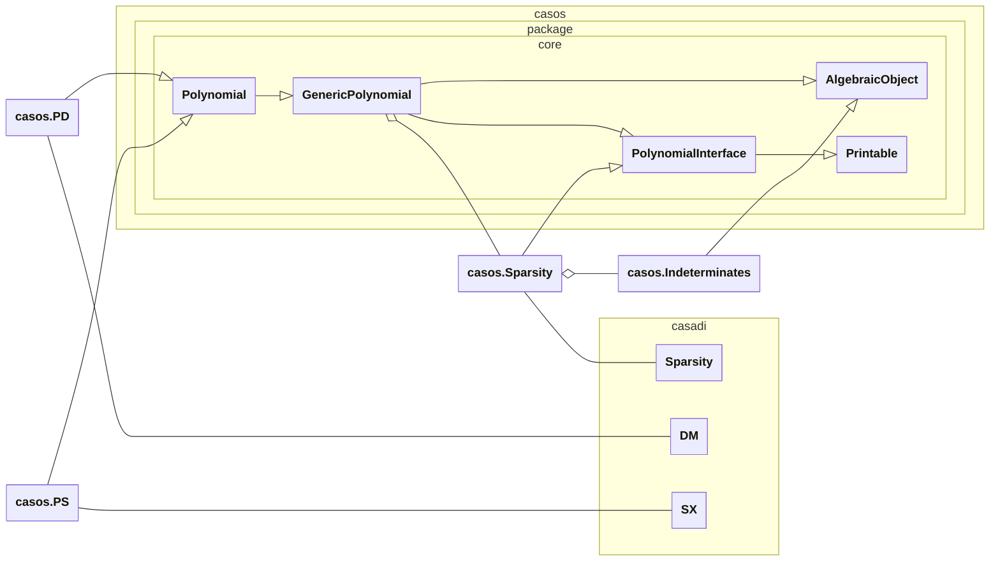
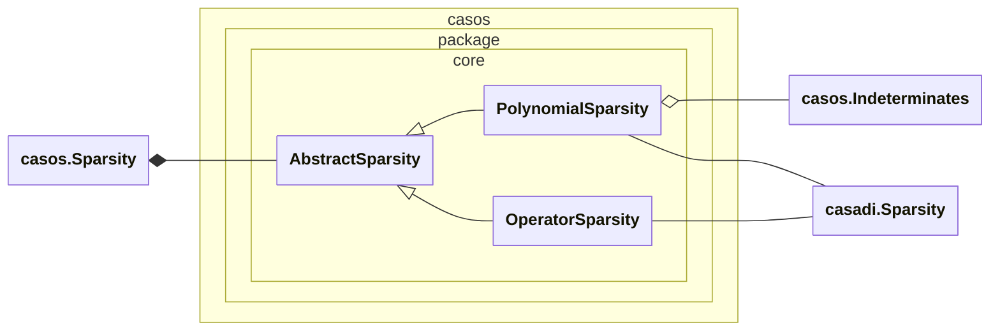
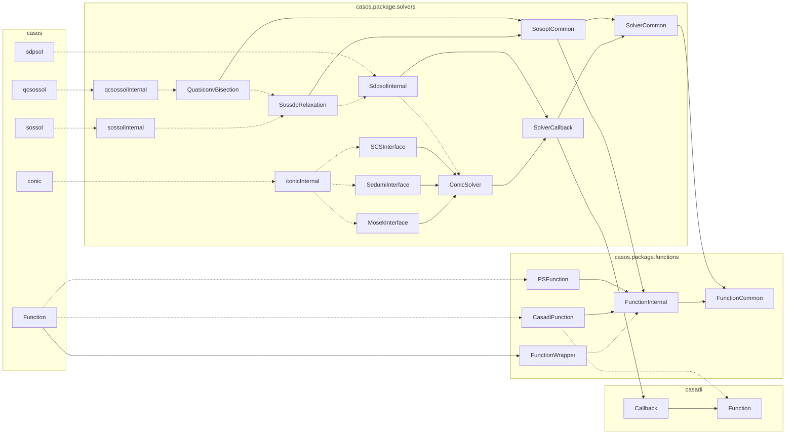

<!--
SPDX-FileCopyrightText: 2023 Institute of Flight Mechanics and Controls, University of Stuttgart
SPDX-FileCopyrightText: Author(s): Torbjørn Cunis <tcunis@ifr.uni-stuttgart.de>
SPDX-FileContributor: For a full list of contributors, see <https://github.com/ifr-ofc/casos>

SPDX-License-Identifier: GPL-3.0-only
-->

# Internal class diagram

## Polynomial types

## Sparsity types

## Functions & Solvers

